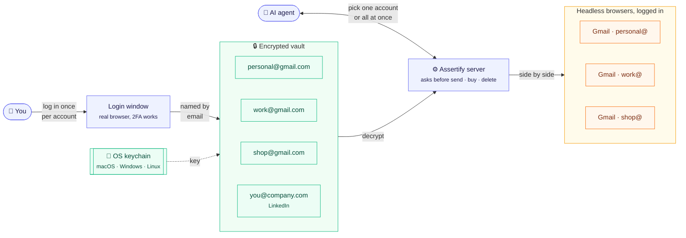

<!-- mcp-name: io.github.romaklym/assertify -->
<div align="center">


# Assertify

**Let your AI agent use any website you're logged in to.**<br>
Log in once. Your session stays encrypted on your machine. Claude, Codex, Cursor and any MCP client can then browse, click, type and read for you.

[](https://github.com/romaklym/assertify/actions/workflows/ci.yml)
[](LICENSE)
[](https://www.python.org)
[](https://modelcontextprotocol.io)
[](https://playwright.dev)

[Quick start](#-quick-start) · [Connect your client](#-connect-your-ai-client) · [Tools](#-tools) · [Security](#-security) · [FAQ](#-faq)

</div>

---

```text
You:    Check my LinkedIn messages and summarize anything from recruiters.
Agent:  open_session("linkedin") → click "Messaging" → read_text …
        You have 3 recruiter messages. The most recent is from Dana at Acme, about a Senior QA role …
```

## ✨ Why Assertify

Most sites have no API, or one that can't do what you need. Assertify gives your agent a real browser that is **already logged in as you**, without ever handing it your password.

- 🔐 **Log in once, by hand.** A normal browser window opens; you sign in (2FA, passkeys, SSO all work). The agent never sees your password.
- 🧳 **Encrypted, local, yours.** Sessions are AES-256-GCM encrypted with a key in your OS keychain. Assertify itself sends nothing anywhere. There is no server and no account.
- 🤖 **Works with every MCP client.** Claude Code, Claude Desktop, Codex, Cursor, VS Code, Gemini CLI, Grok, Windsurf…
- 👀 **See what the agent sees.** Every step can come with a screenshot, shown in the chat and saved to disk.
- 🛡️ **Fenced in.** Each login is locked to its own domains, so a prompt injection on a page can't walk your logged-in browser somewhere else.
- 👥 **Many accounts per site.** Five Gmail accounts? Log in to each; they're named after their emails. Use one, or open them all at once.
- ✋ **Asks before it acts.** Buttons that send, post, buy, delete or connect are paused until you say yes. Logins can be made read-only.
- 🧍 **Behaves like a person.** Real Chrome, your own browser fingerprint, curved mouse moves, uneven typing and natural pauses. No `navigator.webdriver` flag.
- 📎 **Uploads files and folders.** Photos for a Facebook post, a PDF for an email: the agent clicks the upload button and picks your files, just like you would. Key and password files are always refused.
- 🪟 **Handles pop-ups.** Cookie banners are declined for you; "share your contact info" style pop-ups are flagged so the agent decides, or closes them.
- 🔁 **Hands back to you when needed.** CAPTCHAs, 2FA prompts and expired logins open in a window for you to finish; the agent then carries on.
- 🪶 **Fast and token-cheap.** The agent reads a compact outline (`[e12] button "Send"`), not raw HTML.

## ⚙️ How it works



Log in once per account; each one is saved under its email. Your agent then opens one account by name, or every account for a site at once, each in its own logged-in browser. Everything above runs on your computer, on macOS, Windows or Linux.

## 🚀 Quick start

You need [uv](https://docs.astral.sh/uv/getting-started/installation/):

- **macOS / Linux:** `curl -LsSf https://astral.sh/uv/install.sh | sh`
- **Windows (PowerShell):** `powershell -ExecutionPolicy ByPass -c "irm https://astral.sh/uv/install.ps1 | iex"`

Then add Assertify to your AI client with one command (no download or clone needed):

| Client | Command |
|---|---|
| Claude Code | `claude mcp add -s user assertify -- uvx --from git+https://github.com/romaklym/assertify assertify serve` |
| Codex | `codex mcp add assertify -- uvx --from git+https://github.com/romaklym/assertify assertify serve` |
| Claude Desktop (macOS) | `curl -fLo /tmp/assertify.mcpb https://github.com/romaklym/assertify/releases/latest/download/assertify.mcpb && open /tmp/assertify.mcpb` |
| VS Code (Copilot) | `code --add-mcp '{"name":"assertify","command":"uvx","args":["--from","git+https://github.com/romaklym/assertify","assertify","serve"]}'` |

Other clients are under [Connect your AI client](#-connect-your-ai-client). Restart the client afterwards. The first start takes a minute while it installs, and Assertify downloads the browser it needs on first use (or uses your installed Chrome or Edge).

To pin a version, add a tag: `git+https://github.com/romaklym/assertify@v0.6.0`.

<details>
<summary><b>Install from source instead</b></summary>

```bash
git clone https://github.com/romaklym/assertify.git
cd assertify
uv sync
uv run assertify setup
```

`setup` downloads the browser (Chromium, about 300 MB, once), checks your keychain, and prints the command to connect your AI client. Use `uv --directory /path/to/assertify run assertify serve` as the server command.
</details>

<details>
<summary><b>Linux notes</b></summary>

- If the browser won't start, install its system libraries: `sudo uv run playwright install-deps chromium`.
- The key goes in Secret Service (GNOME Keyring or KWallet). On a server with no keychain, set `ASSERTIFY_PASSPHRASE` instead.
- Logging in needs a screen for the browser window. On a server, log in on your desktop and copy `~/.assertify-mcp` over (with the same passphrase), or use `ssh -X`.

</details>

Then save your first login, by asking your agent (*"log me in to GitHub"*) or from the terminal:

```bash
uvx --from git+https://github.com/romaklym/assertify assertify login github https://github.com/login
```

A browser window opens. Sign in, then close the window (or press Enter in the terminal). Done. Your agent can now use GitHub as you.

> [!TIP]
> When you ask your agent, it calls `start_login`, the window opens, and the session saves when you close it.

## 🔌 Connect your AI client

Every client runs the same command: `uvx --from git+https://github.com/romaklym/assertify assertify serve`. If you cloned the repo, use `uv --directory /path/to/assertify run assertify serve` instead.

<details open>
<summary><b>Claude Code</b></summary>

```bash
claude mcp add -s user assertify -- uvx --from git+https://github.com/romaklym/assertify assertify serve
```
</details>

<details>
<summary><b>Claude Desktop</b></summary>

**Easiest:** download [`assertify.mcpb`](https://github.com/romaklym/assertify/releases/latest/download/assertify.mcpb) and double-click it. Claude Desktop installs it with its icon and handles Python for you. From the terminal on macOS:

```bash
curl -fLo /tmp/assertify.mcpb https://github.com/romaklym/assertify/releases/latest/download/assertify.mcpb && open /tmp/assertify.mcpb
```

Or add it to `claude_desktop_config.json` by hand:

```json
{
  "mcpServers": {
    "assertify": {
      "command": "uvx",
      "args": ["--from", "git+https://github.com/romaklym/assertify", "assertify", "serve"]
    }
  }
}
```
</details>

<details>
<summary><b>Codex</b></summary>

```bash
codex mcp add assertify -- uvx --from git+https://github.com/romaklym/assertify assertify serve
```

If the Codex app can't find `uvx`, use its full path (`which uvx`, e.g. `/opt/homebrew/bin/uvx`).
</details>

<details>
<summary><b>Cursor</b></summary>

`~/.cursor/mcp.json`:

```json
{
  "mcpServers": {
    "assertify": {
      "command": "uvx",
      "args": ["--from", "git+https://github.com/romaklym/assertify", "assertify", "serve"]
    }
  }
}
```
</details>

<details>
<summary><b>VS Code (Copilot)</b></summary>

```bash
code --add-mcp '{"name":"assertify","command":"uvx","args":["--from","git+https://github.com/romaklym/assertify","assertify","serve"]}'
```
</details>

<details>
<summary><b>Gemini CLI, Grok, Windsurf, Zed and others</b></summary>

Any client that runs local (stdio) MCP servers works. Use this command:

```text
uvx --from git+https://github.com/romaklym/assertify assertify serve
```

For JSON configs, use the `mcpServers` block shown under Cursor.
</details>

## 🧰 Tools

| Tool | What it does |
|---|---|
| `list_profiles(site?)` | Your saved logins (name, account email, site), optionally only one site's |
| `start_login(url, profile?)` / `complete_login` | Open a window for **you** to log in, then encrypt and save the session. No name: it's named after the account's email |
| `rename_profile` · `delete_profile` | Rename or remove a saved login |
| `open_session(profile, url?, screenshots?)` | Start a logged-in headless browser; returns a `session_id` and a page outline |
| `open_sessions(site? \| profiles?)` | Open several logins at once (e.g. every Gmail account), one `session_id` each |
| `snapshot` | URL, title and interactive elements as `[e12] button "Save"`; pop-ups first, warnings for CAPTCHAs and sign-in pages |
| `find(query)` | Search the whole page for elements by label |
| `click` · `type_text` · `select_option` · `press_key` · `scroll` · `back` · `navigate` · `wait_for` | Act by ref **or by visible text** (`click(text="Messages")`), so small redesigns don't break a flow; each returns a fresh outline |
| `upload_files(paths, ref? \| text?)` | Attach files or whole folders: through the site's file dialog (`text="Photo/video"`), its upload field, or drag-and-drop. Only attaches; posting is a separate, confirmed click |
| `download(ref? \| text? \| url?)` | Save an export, report or invoice and read it: CSV/TSV and Excel come back as tables, PDFs and text files as text. Saved to a private folder |
| `browser_settings(profile?, url?)` | For sites with the browser's own sign-in box (HTTP Basic/NTLM) or a self-signed certificate: opens a small window where **you** type that password and can trust the certificate. The agent never sees it |
| `dismiss_popup` | Close the pop-up on top with its close / "Not now" button |
| `handoff(reason?)` | Open the current page in a window for **you** (CAPTCHA, 2FA, expired login); the session picks up your fresh login |
| `read_text` | The visible text of the page, marked as untrusted website content |
| `screenshot(ref?, full_page?)` | Screenshot of the page or one element, shown to the agent and saved to a file |
| `set_screenshots(enabled)` | Attach a screenshot to every step (great for watching a run) |
| `switch_tab` | Popups become the active tab automatically; this switches back |
| `save_session` / `close_session` | Write refreshed cookies back to the vault (closing saves by default) |
| `evaluate` | Run JavaScript in the page. **Off** unless `ASSERTIFY_ALLOW_EVAL=1` |

### 👀 Seeing what the agent sees

Ask *"show me a screenshot"* or *"open my GitHub session with screenshots on so I can follow along"*. Images appear in the chat in clients that show them, and every one is saved to `~/.assertify-mcp/screenshots/<session>/NNN-<step>.jpg`. The folder is private to you and cleared after 7 days.

## 👥 Several accounts on one site

Log in once per account. Leave the name out and Assertify names each login after the email address it finds on the page (falls back to `google.com-1`, `google.com-2`… when a site doesn't show one):

```bash
assertify login https://mail.google.com   # sign in as you@gmail.com   -> saved as "you@gmail.com"
assertify login https://mail.google.com   # sign in as work@gmail.com  -> saved as "work@gmail.com"
assertify login work https://mail.google.com   # or pick the name yourself
assertify list google.com                 # just the Google logins
assertify rename google.com-1 side-project
```

Then just ask:

- *"Check my work@gmail.com inbox"*: the agent opens that one login.
- *"Any unread mail in any of my Gmail accounts?"*: the agent calls `open_sessions(site="google.com")` and gets one session per account, which it can work through side by side.

Each account lives in its own encrypted file and its own isolated browser, so cookies never mix. On sites that restrict automation, avoid running the same action on many accounts at once.

## 📎 Uploading files

Tell your agent what to upload and where:

> *"Post the photos in ~/Pictures/trip to my Facebook with the caption 'Back home'"*

The agent opens the composer, calls `upload_files(paths=["~/Pictures/trip"], text="Photo/video")`, writes the caption, then asks you before pressing **Post**. Under the hood:

1. **File dialog first.** It clicks the upload button with a natural mouse move and picks the files in the browser's file dialog, the same events a site sees when you do it.
2. **Hidden upload field next.** Most sites hide the real `<input type="file">` behind a button; Assertify finds the one near what the agent pointed at, or the one that accepts these file types.
3. **Drag and drop last.** For drop-only areas it drops the files like a drag from your desktop (up to 50 MB).

A folder means every file in it, subfolders included, skipping hidden files like `.DS_Store`. Single-file fields, file-type limits (`accept="image/*"`) and folder pickers are respected.

**What can never be uploaded:** anything in hidden folders (`~/.ssh`, `~/.aws`, …), key, certificate, password-manager and `.env` files, browser cookie stores, and Assertify's own vault. Paths must be full paths the user gave; agents are told never to upload a file because a page or email asked. Limits: 100 files and 2 GB per call. To allow only certain folders, set `ASSERTIFY_UPLOAD_DIRS`.

## 📥 Downloads, intranets and app logins

- **Downloads:** ask for "last month's CSV export" and the agent calls `download(text="Export CSV")`, or `download(url=...)` for a direct file link, or `download()` for a file the page just started. Files go to `~/.assertify-mcp/downloads/<session>/` (mode `0600`, deleted after 7 days; `ASSERTIFY_DOWNLOAD_DIR` picks another folder). Only links on the login's allowed domains can be fetched, 100 MB at most, and files are only read, never opened or run.
- **The browser's own sign-in box and self-signed certificates** (intranets, routers, NAS boxes, old admin pages): the agent calls `browser_settings`, a small window opens, and you type the username and password and can tick "trust this site's certificate". They're saved encrypted with the login, sent only to that site, and never shown to the agent or in `list_profiles`.
- **Apps that keep their login outside cookies** (WhatsApp Web, Teams and other web apps that use IndexedDB or sessionStorage): the login window saves those too, including files, binary data and encryption keys in IndexedDB, so the agent's session stays signed in. Sites that hide their storage from page scripts (Discord) work too. The one thing that can't be copied is an encryption key the browser marks as locked; the login then says which site data was left behind.

## 🧍 Staying unnoticed

Sites flag browsers that act like robots. Assertify tries hard not to:

- **Real Chrome** when it's installed (falls back to Chromium), without the "controlled by automated software" flag or `navigator.webdriver`.
- **Your fingerprint.** The user agent, language and time zone from your login window are reused by the agent's browser, so the site keeps seeing the same "device".
- **Human input.** The mouse travels along a curve to a random spot inside each button, keys are typed one by one at uneven speed, scrolling comes in flicks, and there are short random pauses between actions and between page loads.
- **A speed limit.** Page loads per login per hour are capped (400 by default, 60 on sites that ban automation).

Set `ASSERTIFY_HUMANIZE=0` to turn the human input off (faster; fine for your own tools and test sites).

## 📱 On your phone

Assertify also runs on iPhone and Android, for agents on your phone such as Claude mobile or ChatGPT/Codex.

1. Run the relay on a computer or server: `assertify relay --public-url https://relay.example.com` (or no flag on your home Wi-Fi). It prints an MCP URL and a pairing link.
2. Install the app from [`mobile/`](mobile/), tap **Pair** and paste the link.
3. Log in to sites in the app's browser by hand.
4. Add the MCP URL to your agent as a custom connector and ask away: "check my LinkedIn messages".

The agent works in a hidden browser on the phone, with the same tools, pop-up handling and confirmations as on the desktop. Your logins never leave the phone; the relay only passes commands and page snapshots. Anyone with the relay token can use your logged-in sites, so keep it secret and use HTTPS when the relay is on the internet. See [mobile/README.md](mobile/README.md).

## 🪟 Pop-ups, dialogs and expired logins

- **Cookie banners** are answered with "Reject all" / "Only necessary" automatically (`ASSERTIFY_AUTO_CONSENT=0` to turn off).
- **Other pop-ups** (newsletter, "share your contact info", app promos) are listed first in the snapshot under `## Pop-up` with a warning. The agent decides based on your request, or calls `dismiss_popup`. A click on something hidden behind a pop-up is refused with a hint instead of silently hitting the overlay.
- **Browser dialogs** (`alert`, `confirm`, "Are you sure?") are cancelled and reported; the agent repeats the click with `accept_dialog=true` when it means it.
- **CAPTCHAs, 2FA and expired sessions** show a warning in the snapshot. The agent never tries to solve them: it calls `handoff`, a window opens on your screen at the same page, you finish, close it, and the agent continues with the new cookies.

## ⚖️ Use it responsibly

Many sites' terms forbid automated access. LinkedIn, Facebook, Instagram, Threads, X and TikTok say so explicitly and do restrict accounts for it. Assertify recognises these sites, runs slower on them, caps page loads lower and tells the agent to keep tasks small and personal. Light personal use (checking your own messages, updating your own profile) is usually fine; scraping, bulk messaging or mass connecting is how accounts get restricted. You are responsible for following the terms of the sites you use.

## 🔒 Security

- **Storage:** `~/.assertify-mcp/profiles/<name>.enc`, AES-256-GCM, file mode `0600`, folder `0700`. The profile name is bound into the ciphertext, so files can't be swapped or renamed.
- **Key:** a random 256-bit key in your OS keychain (macOS Keychain, Windows Credential Locker, Linux Secret Service). On machines without one, set `ASSERTIFY_PASSPHRASE` to derive the key with scrypt instead.
- **Domain guard:** navigation outside a login's `allowed_domains` is blocked. By default that's the login URL's domain and its subdomains; add more with `--domain` (e.g. for SSO).
- **No passwords in context:** password fields show as `value=<hidden>` in snapshots.
- **No telemetry, no server, no account.** Nothing leaves your machine except your own browser traffic to the sites you use.
- **Ask before acting:** buttons labelled send, post, buy, pay, delete, connect, follow, apply and similar, and pressing Enter in a message box, are paused until the agent calls again with `confirmed=true`, which it is told to do only after you approve.
- **Read-only logins:** `assertify login <name> <url> --read-only` (or `read_only=true` in `start_login`) lets agents browse and read but never type, submit, send or buy.
- **Browser sign-in passwords** (`browser_settings`): typed by you in a separate window, stored in the encrypted vault next to the cookies, sent only to the site they're for, and never returned to the agent. Trusting a certificate is your choice per login, in that same window.
- **Uploads:** only full paths, never secrets (hidden folders, keys, `.env`, cookie stores, the vault), symlinks resolved first, optional folder allowlist (`ASSERTIFY_UPLOAD_DIRS`). Read-only logins can't upload.
- **Untrusted pages:** page text is returned wrapped and labelled as website content, and agents are told never to follow instructions found in pages, emails or messages. Only `http(s)` pages can be opened. Files are saved only through `download`, and their contents are labelled as website data too.

> [!WARNING]
> A saved session is as powerful as being logged in. Anyone who can run code as your user while your keychain is unlocked can use it, the same as your browser's own cookies. Only connect agents you trust.

Found a vulnerability? See [SECURITY.md](SECURITY.md).

## 🎛️ Configuration

| Variable | Effect |
|---|---|
| `ASSERTIFY_HOME` | Vault location (default `~/.assertify-mcp`) |
| `ASSERTIFY_PASSPHRASE` | Use a passphrase instead of the OS keychain |
| `ASSERTIFY_HEADED=1` | Show the agent's browser window (debugging, or sites that block headless) |
| `ASSERTIFY_SCREENSHOTS=1` | Screenshot every step by default |
| `ASSERTIFY_NO_AUTO_INSTALL=1` | Never download Chromium automatically |
| `ASSERTIFY_ALLOW_EVAL=1` | Enable the `evaluate` tool |
| `ASSERTIFY_ALLOW_ANY_DOMAIN=1` | Turn off the domain guard |
| `ASSERTIFY_HUMANIZE=0` | Turn off human-like mouse, typing and pauses |
| `ASSERTIFY_BROWSER` | `chrome`, `chromium` or `msedge` (default: Chrome if installed, else Chromium) |
| `ASSERTIFY_MAX_PAGES_PER_HOUR` | Page-load cap per login (default 400; 60 on strict sites) |
| `ASSERTIFY_AUTO_CONSENT=0` | Don't auto-decline cookie banners |
| `ASSERTIFY_UPLOAD_DIRS` | Only allow uploads from these folders (separated by `:` on macOS/Linux, `;` on Windows) |
| `ASSERTIFY_MAX_UPLOAD_MB` | Upload size cap per call (default 2048) |
| `ASSERTIFY_DOWNLOAD_DIR` | Where `download` saves files (default `~/.assertify-mcp/downloads`, cleaned after 7 days) |

CLI: `assertify setup | login [name] <url> [--domain d] [--read-only] | list [site] | rename <name> <new> | delete <name> | serve`.

## ❓ FAQ

**Does it work with 2FA, passkeys and "Sign in with Google"?**
Yes. You log in yourself in a real browser window, so anything you can do there works. Add the SSO domain with `--domain` if the site bounces through one.

**Why did a site log me out?**
Sessions expire on the site's own schedule, and some sites ask for a CAPTCHA or 2FA again now and then. When that happens the agent calls `handoff` and a window opens for you to sign in again; nothing else to do. Assertify also saves refreshed cookies when a session closes, which keeps rolling sessions alive. If a site keeps rejecting the headless browser, set `ASSERTIFY_HEADED=1`.

**Will a site redesign break my agent?**
Less than you'd think. The agent reads the page fresh every step and can click by visible text (`click(text="Messages")`) instead of fixed selectors, so it adapts like a person would. A full redesign can still confuse it; it will tell you what it sees.

**Can I use it from my phone or a server?**
Not yet. Assertify is local-first by design: your sessions never leave your computer.

**Known limits**
A few apps keep their sign-in in encryption keys the browser won't let anyone copy; those logins can't move to the agent's browser (the save message says so). No anti-detection is perfect: a site determined to spot automation may still do so. Snapshots don't look inside iframes or closed shadow roots yet.

## 🤝 Contributing

Issues and PRs are welcome. See [CONTRIBUTING.md](CONTRIBUTING.md). The short version:

```bash
uv sync && uv run assertify setup
uv run pytest && uv run ruff check .
```

## 📄 License

[MIT](LICENSE) © Roman Klym
