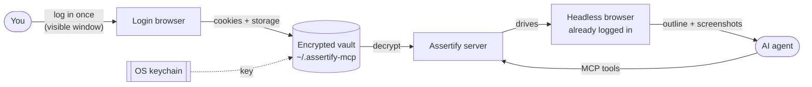

<!-- mcp-name: io.github.romaklym/assertify -->
<div align="center">


# Assertify

**Let your AI agent use any website you're logged in to.**<br>
Log in once. Your session stays encrypted on your machine. Claude, Codex, Cursor and any MCP client can then browse, click, type and read for you.

[](https://github.com/romaklym/assertify-mcp/actions/workflows/ci.yml)
[](LICENSE)
[](https://www.python.org)
[](https://modelcontextprotocol.io)
[](https://playwright.dev)

[Quick start](#-quick-start) · [Connect your client](#-connect-your-ai-client) · [Tools](#-tools) · [Security](#-security) · [FAQ](#-faq)

</div>

---

```text
You:    Check my LinkedIn messages and summarize anything from recruiters.
Agent:  open_session("linkedin") → click "Messaging" → read_text …
        You have 3 recruiter messages. The most recent is from Dana at Acme, about a Senior QA role …
```

## ✨ Why Assertify

Most sites have no API, or one that can't do what you need. Assertify gives your agent a real browser that is **already logged in as you**, without ever handing it your password.

- 🔐 **Log in once, by hand.** A normal browser window opens; you sign in (2FA, passkeys, SSO all work). The agent never sees your password.
- 🧳 **Encrypted, local, yours.** Sessions are AES-256-GCM encrypted with a key in your OS keychain. Nothing is uploaded anywhere. There is no server and no account.
- 🤖 **Works with every MCP client.** Claude Code, Claude Desktop, Codex, Cursor, VS Code, Gemini CLI, Grok, Windsurf…
- 👀 **See what the agent sees.** Every step can come with a screenshot, shown in the chat and saved to disk.
- 🛡️ **Fenced in.** Each login is locked to its own domains, so a prompt injection on a page can't walk your logged-in browser somewhere else.
- 🪶 **Fast and token-cheap.** The agent reads a compact outline (`[e12] button "Send"`), not raw HTML.

## ⚙️ How it works



Everything above runs on your computer.

## 🚀 Quick start

You need [uv](https://docs.astral.sh/uv/getting-started/installation/) (`curl -LsSf https://astral.sh/uv/install.sh | sh`).

```bash
git clone https://github.com/romaklym/assertify-mcp.git
cd assertify-mcp
uv sync
uv run assertify setup
```

`setup` downloads the browser (Chromium, about 300 MB, once), checks your keychain, and prints the exact command to connect your AI client. If you skip it, Assertify downloads the browser on first use, or falls back to your installed Chrome or Edge.

Then save your first login:

```bash
uv run assertify login github https://github.com/login
```

A browser window opens. Sign in, then close the window (or press Enter in the terminal). Done. Your agent can now use GitHub as you.

> [!TIP]
> You can also just ask your agent: *"log me in to Notion"*. It calls `start_login`, the window opens, and the session saves when you close it.

## 🔌 Connect your AI client

Replace `/path/to/assertify-mcp` with where you cloned it (`assertify setup` prints the exact line for you).

<details open>
<summary><b>Claude Code</b></summary>

```bash
claude mcp add -s user assertify -- uv --directory /path/to/assertify-mcp run assertify serve
```
</details>

<details>
<summary><b>Claude Desktop</b></summary>

**Easiest:** download [`assertify.mcpb`](https://github.com/romaklym/assertify-mcp/releases/latest/download/assertify.mcpb) and double-click it. Claude Desktop installs it with its icon and handles Python for you.

Or add it to `claude_desktop_config.json` by hand:

```json
{
  "mcpServers": {
    "assertify": {
      "command": "uv",
      "args": ["--directory", "/path/to/assertify-mcp", "run", "assertify", "serve"]
    }
  }
}
```
</details>

<details>
<summary><b>Codex</b></summary>

```bash
codex mcp add assertify -- uv --directory /path/to/assertify-mcp run assertify serve
```

or in `~/.codex/config.toml`:

```toml
[mcp_servers.assertify]
command = "uv"
args = ["--directory", "/path/to/assertify-mcp", "run", "assertify", "serve"]
```
</details>

<details>
<summary><b>Cursor</b></summary>

`~/.cursor/mcp.json`:

```json
{
  "mcpServers": {
    "assertify": {
      "command": "uv",
      "args": ["--directory", "/path/to/assertify-mcp", "run", "assertify", "serve"]
    }
  }
}
```
</details>

<details>
<summary><b>VS Code (Copilot)</b></summary>

`.vscode/mcp.json`:

```json
{
  "servers": {
    "assertify": {
      "type": "stdio",
      "command": "uv",
      "args": ["--directory", "/path/to/assertify-mcp", "run", "assertify", "serve"]
    }
  }
}
```
</details>

<details>
<summary><b>Gemini CLI, Grok, Windsurf, Zed and others</b></summary>

Any client that runs local (stdio) MCP servers works. Use this command:

```text
uv --directory /path/to/assertify-mcp run assertify serve
```

For JSON configs, use the `mcpServers` block shown under Cursor.
</details>

## 🧰 Tools

| Tool | What it does |
|---|---|
| `list_profiles` | Your saved logins |
| `start_login` / `complete_login` | Open a window for **you** to log in, then encrypt and save the session |
| `delete_profile` | Remove a saved login |
| `open_session(profile, url?, screenshots?)` | Start a logged-in headless browser; returns a `session_id` and a page outline |
| `snapshot` | URL, title and interactive elements as `[e12] button "Save"` |
| `click` · `type_text` · `select_option` · `press_key` · `scroll` · `back` · `navigate` · `wait_for` | Act on refs from the latest snapshot; each returns a fresh outline |
| `read_text` | The visible text of the page |
| `screenshot(ref?, full_page?)` | Screenshot of the page or one element, shown to the agent and saved to a file |
| `set_screenshots(enabled)` | Attach a screenshot to every step (great for watching a run) |
| `switch_tab` | Popups become the active tab automatically; this switches back |
| `save_session` / `close_session` | Write refreshed cookies back to the vault (closing saves by default) |
| `evaluate` | Run JavaScript in the page. **Off** unless `ASSERTIFY_ALLOW_EVAL=1` |

### 👀 Seeing what the agent sees

Ask *"show me a screenshot"* or *"open my GitHub session with screenshots on so I can follow along"*. Images appear in the chat in clients that show them, and every one is saved to `~/.assertify-mcp/screenshots/<session>/NNN-<step>.jpg`. The folder is private to you and cleared after 7 days.

## 🔒 Security

- **Storage:** `~/.assertify-mcp/profiles/<name>.enc`, AES-256-GCM, file mode `0600`, folder `0700`. The profile name is bound into the ciphertext, so files can't be swapped or renamed.
- **Key:** a random 256-bit key in your OS keychain (macOS Keychain, Windows Credential Locker, Linux Secret Service). On machines without one, set `ASSERTIFY_PASSPHRASE` to derive the key with scrypt instead.
- **Domain guard:** navigation outside a login's `allowed_domains` is blocked. By default that's the login URL's domain and its subdomains; add more with `--domain` (e.g. for SSO).
- **No passwords in context:** password fields show as `value=<hidden>` in snapshots.
- **No telemetry, no server, no account.** Nothing leaves your machine except your own browser traffic to the sites you use.
- **Ask before acting:** the server tells agents to confirm with you before purchases, sending messages or deleting data.

> [!WARNING]
> A saved session is as powerful as being logged in. Anyone who can run code as your user while your keychain is unlocked can use it, the same as your browser's own cookies. Only connect agents you trust.

Found a vulnerability? See [SECURITY.md](SECURITY.md).

## 🎛️ Configuration

| Variable | Effect |
|---|---|
| `ASSERTIFY_HOME` | Vault location (default `~/.assertify-mcp`) |
| `ASSERTIFY_PASSPHRASE` | Use a passphrase instead of the OS keychain |
| `ASSERTIFY_HEADED=1` | Show the agent's browser window (debugging, or sites that block headless) |
| `ASSERTIFY_SCREENSHOTS=1` | Screenshot every step by default |
| `ASSERTIFY_NO_AUTO_INSTALL=1` | Never download Chromium automatically |
| `ASSERTIFY_ALLOW_EVAL=1` | Enable the `evaluate` tool |
| `ASSERTIFY_ALLOW_ANY_DOMAIN=1` | Turn off the domain guard |

CLI: `assertify setup | login <name> <url> [--domain d] | list | delete <name> | serve`.

## ❓ FAQ

**Does it work with 2FA, passkeys and "Sign in with Google"?**
Yes. You log in yourself in a real browser window, so anything you can do there works. Add the SSO domain with `--domain` if the site bounces through one.

**Why did a site log me out?**
Some sites tie sessions to a device or detect headless browsers. Run the login again, or set `ASSERTIFY_HEADED=1`. Sessions also expire on the site's own schedule; Assertify saves refreshed cookies when a session closes, which keeps rolling sessions alive.

**Can I use it from my phone or a server?**
Not yet. Assertify is local-first by design: your sessions never leave your computer.

**Known limits**
Login saves cookies and localStorage, not IndexedDB, so a few apps that keep their token only in IndexedDB won't stay logged in. Snapshots don't look inside iframes or closed shadow roots yet.

## 🤝 Contributing

Issues and PRs are welcome. See [CONTRIBUTING.md](CONTRIBUTING.md). The short version:

```bash
uv sync && uv run assertify setup
uv run pytest && uv run ruff check .
```

## 📄 License

[MIT](LICENSE) © Roman Klym
